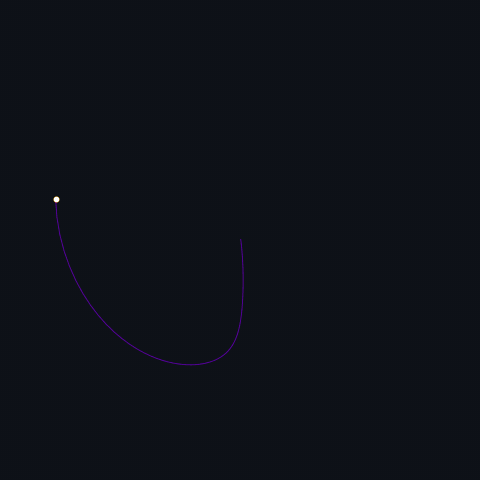
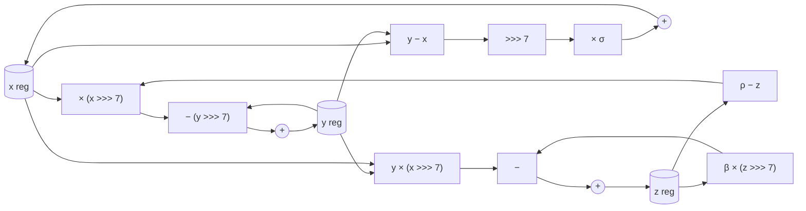
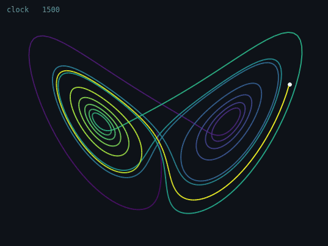
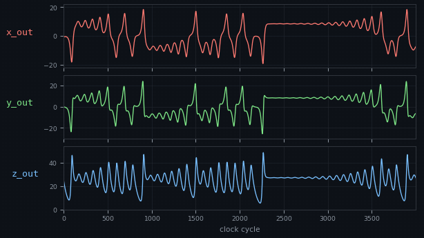
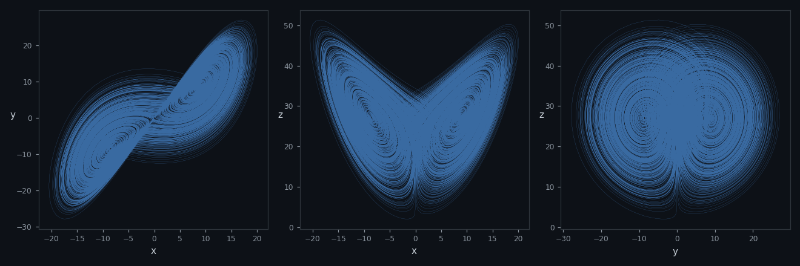

# lorenz-attractor

A **Lorenz attractor solver in Verilog** that uses fixed-point arithmetic. Each clock cycle it does one
Euler integration step of the Lorenz system and outputs the new `x`, `y`, `z` state. It was written
for the Terasic **DE1-SoC** (Intel Cyclone V) and simulated in **ModelSim**.

<p align="center">
  
</p>

<p align="center"><i>The first 8,000 clock cycles of <code>x_out</code>, <code>y_out</code> and <code>z_out</code>, taken directly from the ModelSim simulation.</i></p>

## The Lorenz system

$$
\frac{dx}{dt} = \sigma\,(y - x) \qquad
\frac{dy}{dt} = x\,(\rho - z) - y \qquad
\frac{dz}{dt} = x\,y - \beta\,z
$$

The design uses the classic chaotic parameters **σ = 10, ρ = 28, β = 8/3** and starts from
**(x, y, z) = (−1, 0.1, 25)**.

## How it works

### Fixed-point format

All signals are **27-bit two's complement, 7.20 format**: 1 sign bit, 6 integer bits and
20 fraction bits. So `1.0 = 2^20 = 1048576`, and the usable range is about ±64.

| Constant | Real value | 7.20 value          |
|----------|-----------:|---------------------|
| σ        | 10         | `27'sd10485760`     |
| ρ        | 28         | `27'sd29360128`     |
| β        | 8/3        | `27'sd2796202`      |
| x₀       | −1         | `-27'sd1048576`     |
| y₀       | 0.1        | `27'sd104857`       |
| z₀       | 25         | `27'sd26214400`     |

### Euler integration with a shift for dt

The time step is **dt = 1/128 = 2⁻⁷**. The design doesn't multiply by `dt`. It shifts one operand of
each product right by 7 bits (`>>> 7`), so each derivative block already outputs `dt · d/dt`, and
the state registers only need an add:

```
x <= x + σ·((y − x) >>> 7)                  // x + dt·σ(y − x)
y <= y + (ρ − z)·(x >>> 7) − (y >>> 7)      // y + dt·(x(ρ − z) − y)
z <= z + y·(x >>> 7) − β·(z >>> 7)          // z + dt·(xy − βz)
```

So the design needs 4 multipliers, 4 subtractors and 3 adders, and finishes one full integration step every clock.



### Arithmetic modules

- **`signed_mult`**: 27 × 27 → 54-bit product. The result is taken as `{p[53], p[45:20]}`, which
  realigns the 14.40 product back to 7.20 and keeps the sign.
- **`signed_add`** and **`signed_sub`**: 27-bit add and subtract, computed through a 28-bit
  intermediate.

## Simulation results

The trajectory moves between the two "wings" of the attractor in a chaotic pattern. The view below
traces the x–z plane, and the bright tail shows the most recent 1,500 clock cycles:

<p align="center">
  
</p>

The output signals as waveforms, scrolling in the same way as the ModelSim wave window:

<p align="center">
  
</p>

The full run of **91,212 clock cycles**, about 712 Lorenz time units, projected onto each pair of axes:

<p align="center">
  
</p>

Over the whole run the state stays within x ∈ [−20.5, 20.0], y ∈ [−27.9, 27.0] and z ∈ [2.0, 51.3],
which fits inside the ±64 range of the 7.20 format.

## Repository layout

| File                | Description                                                         |
|---------------------|---------------------------------------------------------------------|
| `lorenz_system.v`   | Top module: state registers, derivative datapath, Euler update      |
| `singed_mult.v`     | `signed_mult`: 7.20 signed multiplier                               |
| `signed_add.v`      | `signed_add`: 7.20 signed adder                                     |
| `signed_sub.v`      | `signed_sub`: 7.20 signed subtractor                                |
| `test_tb.v`         | Small testbench for the arithmetic blocks                           |
| `list.txt`          | ModelSim list output of `x_out`, `y_out`, `z_out` (raw 7.20 values) |
| `docs/`             | README images and the script that generates them                    |

## Running the simulation

1. In ModelSim, create a project and add the five `.v` files. Then compile them all.
2. Start the simulation and set up the clock and reset. These commands are based on the session that
   produced `list.txt`:

```tcl
vsim -gui work.lorenz_system
add wave -position end sim:/lorenz_system/clk
add wave -position end sim:/lorenz_system/reset
add wave -position end sim:/lorenz_system/x_out
add wave -position end sim:/lorenz_system/y_out
add wave -position end sim:/lorenz_system/z_out
force -freeze sim:/lorenz_system/clk 1 0, 0 {50 ps} -r 100
force -freeze sim:/lorenz_system/reset 1 0
run
force -freeze sim:/lorenz_system/reset 0 0
run -all
```

3. To see the butterfly in the wave window, set `x_out`, `y_out` and `z_out` to
   *Format → Analog* with a decimal radix. You can also export them with *File → Export → List*.

To convert a raw value to a real number, divide it by 2²⁰. For example, `26214400 / 1048576 = 25.0`.

## Regenerating the animations

The GIFs and the PNG are rendered straight from `list.txt`:

```
pip install numpy matplotlib
python docs/plot_lorenz.py list.txt
```

`ffmpeg` must be on your `PATH`, because the script uses it to build the GIFs.

## Tools

- Intel Quartus Prime Lite 20.1 and ModelSim-Intel FPGA Starter Edition 20.1
- Target board: Terasic DE1-SoC (Cyclone V 5CSEMA5F31C6)
